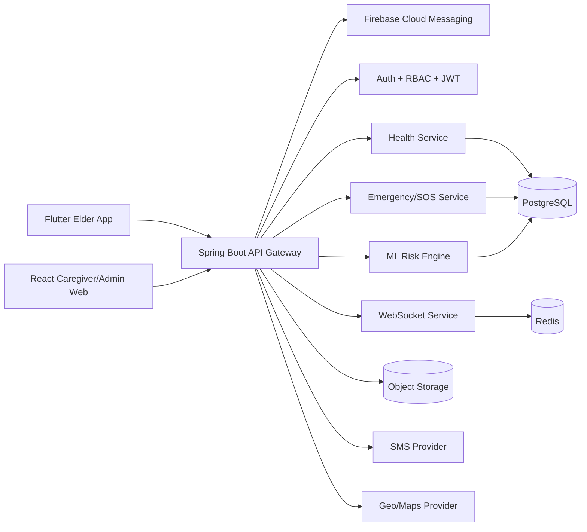

# Care Companion - Production Architecture

## System Architecture

## Deployment Topology
- `web` and `api` deployed behind HTTPS load balancer.
- `mobile` consumes public API.
- `postgres` in managed cloud DB (RDS/Cloud SQL/Azure Database).
- `redis` for sessions, notification queue, and real-time status.
- `ml-service` deployed as separate container with autoscaling.

## Core Non-Functional Requirements
- High availability with rolling deployments and health probes.
- Security: JWT, RBAC, encrypted transport (TLS), encrypted secrets.
- Observability: structured logs, metrics, and alerting.
- Accessibility-first UI with multilingual and high-contrast mode.
